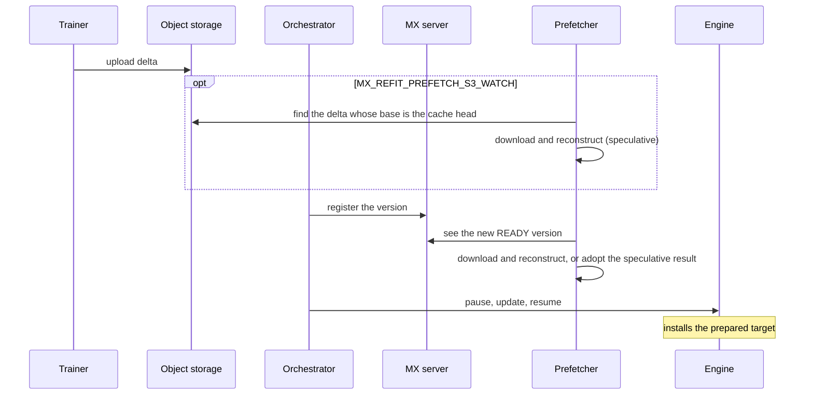
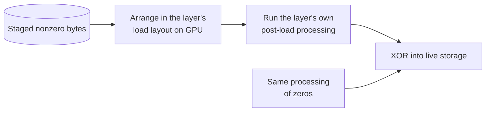
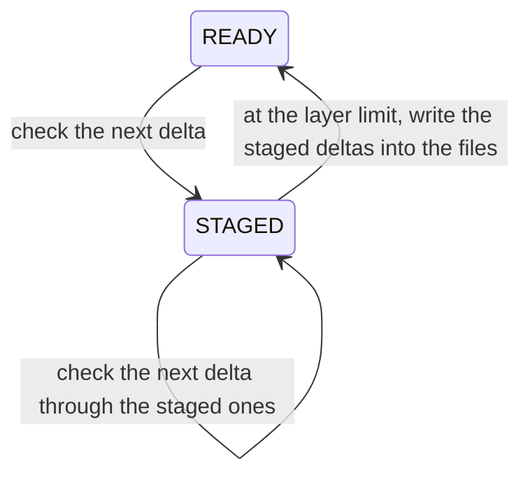

# S3 Delta Weight Refit

This guide shows how to publish XOR-delta weight updates to S3 and install them
in a running vLLM model with ModelExpress. The trainer and generator start from
the same local checkpoint; integrations may use a framework-selected cadence of
full HF checkpoints to reset that base. ModelExpress coordinates each version's
lineage and readiness.

For a runnable Vime TP2 trainer, Dynamo TP1 rollout worker, and SeaweedFS setup, see
[`examples/rl/vime_dynamo_delta_refit`](../examples/rl/vime_dynamo_delta_refit/README.md).

## Components

| Component | Responsibility |
|---|---|
| `ModelExpressControlClient` | Create and transition immutable weight-version records in the ModelExpress catalog. |
| `ModelExpressTrainerClient` | Capture the seed-checkpoint base and publish either XOR deltas or full HF checkpoint batches to S3. |
| `ModelExpressGeneratorClient` | Validate READY versions, apply the requested S3 payload to its refit checkpoint, and reload the live model. |

## Requirements

- A Redis-backed ModelExpress Refit service.
- A ModelExpress build containing the canonical S3 delta and vLLM integrations.
- The `modelexpress` Python package installed in both the trainer environment
  and the environment used to launch vLLM.
- vLLM 0.27.1.
- Trainer ranks with S3 read/write access and vLLM hosts with read access.
- The corresponding base checkpoint in safetensors format on every trainer and
  vLLM host.

Minimal ModelExpress server configuration:

```bash
export MX_METADATA_BACKEND=redis
export REDIS_URL=redis://redis:6379
```

Environment variables used by the clients and vLLM engine:

| Variable | Default | Purpose |
|---|---|---|
| `MX_SERVER_ADDRESS` | `localhost:8001` | ModelExpress server address. |
| `MX_MODEL_NAME_OVERRIDE` | unset | Logical MX model name used by vLLM at startup and during refit. Use the same name for trainer clients and published WeightVersions. Without it, vLLM's configured model path or ID is used. |
| `MX_AUTH_TOKEN_PATH` | unset | Optional ModelExpress bearer-token file. |
| `MX_AUTH_TOKEN_TTL_SECONDS` | `60` | Token-file reread interval in seconds. |
| `AWS_ACCESS_KEY_ID`, `AWS_SECRET_ACCESS_KEY` | unset | S3 credentials when an IAM role or workload identity is unavailable. |
| `AWS_SESSION_TOKEN` | unset | Session token when using temporary AWS credentials. |
| `AWS_DEFAULT_REGION` | unset | S3 region when `region_name` is not supplied in client configuration. |
| `MX_REFIT_DELTA_BUCKET_BYTES` | `536870912` (512 MiB) | Optional tensor-bucket size override for framework integrations. |
| `MX_REFIT_DELTA_WORKERS` | `min(32, CPU count)` | CPU workers used to compute and apply XOR deltas. |
| `MX_REFIT_PREFETCH` | `false` | Prepare new versions in a background process before the update pauses the engine. See [Background prefetch](#background-prefetch). |
| `MX_REFIT_PREFETCH_S3_WATCH` | `false` | Also prepare deltas found in S3 before their versions are registered. Requires `MX_REFIT_PREFETCH`. |
| `MX_REFIT_PREFETCH_POLL_SECONDS` | `2` | How often the prefetcher checks for new versions. |
| `MX_REFIT_PREFETCH_WORKERS` | `min(8, CPU count)` | CPU workers the prefetcher uses to apply deltas while the engine serves. |
| `MX_REFIT_PREFER_PREPARED` | `false` | Install a locally prepared target from object storage before trying a generator peer. |
| `MX_REFIT_INPLACE` | `false` | Stage each prepared delta's nonzero XOR bytes and install the delta into live vLLM weights in place instead of reloading. A delta is verified and installed before the checkpoint files are rewritten. See [In-place install](#in-place-install). |
| `MX_REFIT_STAGED_LAYERS` | `8` | Most deltas staged on the checkpoint files at once. Below it, a delta is checked through the staged ones without writing; at it, a preparation writes them into the files first. See [Install before rewrite](#install-before-rewrite). |
| `MX_REFIT_FULL_CHECK_INTERVAL` | `8` | A delta's check reads a tensor with a verified checksum only where the delta changes it, except in one of this many deltas, where it reads the tensor in full. `1` reads every tensor in full. See [Install before rewrite](#install-before-rewrite). |
| `MX_REFIT_NATIVE_CHECK` | `true` | Check deltas in the C++ delta checker when the client was built with it. `false` checks them in Python. See [Install before rewrite](#install-before-rewrite). |
| `MX_REFIT_CHECKSUM_FORMAT` | `adler32` | Checksum algorithm written by canonical S3 trainers. |
| `MX_REFIT_FULL_CHECKPOINT_BATCH_BYTES` | `4294967296` (4 GiB) | Maximum tensor bytes grouped into one full-checkpoint safetensors object. |
| `MX_S3_UPLOAD_WORKERS` | `8` | Maximum concurrent multipart uploads per trainer rank. |
| `MX_S3_DOWNLOAD_WORKERS` | `16` | Generator download concurrency. |
| `MX_S3_MAX_POOL_CONNECTIONS` | `32` | Botocore HTTP connection-pool size. |
| `MX_S3_MAX_ATTEMPTS` | `5` | Total S3 request attempts. |
| `VLLM_SERVER_DEV_MODE` | unset | Set to `1` to enable vLLM's weight-update HTTP routes. Network-isolate these routes. |
| `VLLM_PLUGINS` | unset | Set to `modelexpress` to load the ModelExpress vLLM plugin. |

Optional S3 tuning variables and defaults are documented in
[`modelexpress_client/python/README.md`](../modelexpress_client/python/README.md#canonical-s3-transfer-tuning).

## Initialization

### 1. Create the base version

Create a READY initial WeightVersion before initializing trainer or generator
clients. The current API requires a syntactically valid object-storage URI, but
this local seed-checkpoint flow does not upload or read an object at that URI.

```python
from modelexpress_rl import (
    ModelExpressControlClient,
    ModelExpressTrainerClient,
    ModelExpressTrainerConfig,
    ObjectStorageConfig,
    ObjectStorageSource,
    ObjectStorageType,
    TrainerStagingMode,
    WeightPayloadFormat,
    WeightVersionState,
)

S3_URI_PREFIX = "s3://my-bucket/weights"

with ModelExpressControlClient.connect(
    server_url="modelexpress:8001",
) as control:
    base = control.create_weight_version(
        uid="v0",
        model_name="Qwen/Qwen3-30B-A3B",
        idempotency_key="initialize-v0",
        payload_format=WeightPayloadFormat.FULL_TENSOR,
        object_storage=ObjectStorageSource(  # Catalog-only; no object is uploaded.
            storage_type=ObjectStorageType.S3,
            uri=f"{S3_URI_PREFIX}/v0/model.safetensors.index.json",
        ),
        state=WeightVersionState.READY,
    )
```

Trainer and generator initialization use `base.version_id` as their initial base
ID. They read the real weights from `seed_checkpoint_path`; the base version URI
is not downloaded.

See [`refit.proto`](../modelexpress_common/proto/refit.proto) for the complete
control-plane request and response schemas.

### 2. Initialize the trainer client

Initialize one trainer client on every distributed trainer rank and keep it for
the full training run. `hf_tensor_buckets()` below represents a framework-owned
function that returns a fresh iterable of Hugging Face tensor buckets.

```python
import torch.distributed as dist

trainer = ModelExpressTrainerClient.initialize(
    ModelExpressTrainerConfig(
        model_name="Qwen/Qwen3-30B-A3B",
        staging_mode=TrainerStagingMode.WRITE_TO_STORAGE,
        payload_format=WeightPayloadFormat.XOR_DELTA,
        server_url="modelexpress:8001",
        process_group=...,  # Gloo process group for control plane
        object_storage=ObjectStorageConfig(
            storage_type=ObjectStorageType.S3,
            uri_prefix=S3_URI_PREFIX,
            initial_base_version_id="v0",
            seed_checkpoint_path="/models/Qwen3-30B-A3B",
            region_name="us-west-2",
        ),
    )
)

# Call once before the first optimizer update.
trainer.prepare_delta_base(hf_tensor_iter=hf_tensor_buckets())
```

The bucket names must match tensors in the seed checkpoint. Keep the trainer
client alive because each successful publication advances its retained base
from `v0` to `v1`, then `v2`, and so on.

Use a dedicated Gloo process group containing every participating trainer rank.
ModelExpress uses it for CPU object collectives that coordinate shard and index
publication; do not reuse the model-training NCCL group for this example.

### 3. Initialize the generator

Install the `modelexpress` Python package in the same environment used to run
`vllm serve`. The package provides the vLLM plugin entry point:

```toml
[project.entry-points."vllm.general_plugins"]
modelexpress = "modelexpress:register_modelexpress"
```

`VLLM_PLUGINS=modelexpress` selects that installed plugin. Then start vLLM:

```bash
export VLLM_SERVER_DEV_MODE=1
export VLLM_PLUGINS=modelexpress
export MX_SERVER_ADDRESS=modelexpress:8001
export MX_MODEL_NAME_OVERRIDE=Qwen/Qwen3-30B-A3B

vllm serve /models/Qwen3-30B-A3B \
  --tensor-parallel-size 4 \
  --weight-transfer-config '{"backend":"modelexpress"}'
```

Set `MX_MODEL_NAME_OVERRIDE` before starting vLLM so cold-start version validation,
generator registration, peer identity, and the checkpoint cache use the same
logical name.
For an S3 launch such as `--model s3://bucket/model`, vLLM can rewrite its internal
model name to a local streamer cache path.
`MX_MODEL_NAME_OVERRIDE=s3://bucket/model` keeps the original URI as the MX name;
a name such as `customer-bot` works too. Publish every WeightVersion with that
exact name and configure trainer clients to match.
The adapter resolves the override once on a model-configuration copy used only
for MX identity construction. The original configuration continues to provide
vLLM's model-loading path. Without the override, the existing behavior, including
use of the rewritten path, is unchanged.

An explicit `init_info.model_name` still overrides the transfer client's default
after startup. Keep it consistent with `MX_MODEL_NAME_OVERRIDE`; it cannot change
an identity already used during cold start.

After vLLM is ready, initialize each server once:

```python
import requests

VLLM_URL = "http://vllm-generator:8000"

response = requests.post(
    f"{VLLM_URL}/init_weight_transfer_engine",
    json={
        "init_info": {
            "model_name": "Qwen/Qwen3-30B-A3B",
            "server_url": "modelexpress:8001",
            "object_storage_type": "S3",
            "initial_base_version_id": "v0",
            "seed_checkpoint_path": "/models/Qwen3-30B-A3B",
            "refit_checkpoint_dir": "/var/cache/modelexpress",
            "refit_checkpoint_max_size_gb": 500,
            "object_storage_region_name": "us-west-2",
            "max_transfer_attempts": 3,
            "max_replay_chain_length": 64,
            "rpc_timeout_seconds": 30,
        }
    },
    timeout=900,
)
response.raise_for_status()
```

#### `seed_checkpoint_path`

When supplied, this must be a complete local safetensors checkpoint for
`initial_base_version_id`, readable by every inference engine worker. It may be
either:

- one unsharded `.safetensors` file containing the full model; or
- a directory containing all `.safetensors` shards. If
  `model.safetensors.index.json` is present, every shard referenced by its
  `weight_map` must also be present.

For typical sharded models such as Qwen3-30B-A3B, use the full Hugging Face
snapshot directory.

If desired-version cold start already cached the full checkpoint for
`initial_base_version_id`, omit `seed_checkpoint_path` from `init_info` or set it
to `null`. With the Python `ObjectStorageGeneratorConfig`, pass
`seed_checkpoint_path=None`. ModelExpress resolves the cached full root using
the model name, `refit_checkpoint_dir`, and `initial_base_version_id`; callers do
not need to reproduce the cache path or its URL encoding.

This mode reuses the cached checkpoint without downloading or copying a seed.
Initialization fails if the required root is missing or cannot be restored.
Passing the cached full-root path explicitly retains the same reuse behavior.
Passing an external checkpoint path retains the existing seed-import behavior.

With a cached seed, later full updates carry non-weight files forward from the
current prepared checkpoint. Its directory is protected from eviction until the
copy finishes, so eviction of the original seed does not drop these files.
Explicit external seed paths remain the source of their non-weight files.

#### `refit_checkpoint_dir`

This is the root of ModelExpress's host-local immutable checkpoint cache. During
initialization, ModelExpress creates a model-specific subdirectory containing
full checkpoints, delta payloads, resolved chains, derived materializations,
and activation state. Each artifact directory is written into a
`.checkpoint-<random>` directory beside it and renamed into place once
complete; initialization removes any such directory that a stopped process left
behind.

`full/<version>/` and `deltas/<version>/` contain canonical immutable artifacts.
`chains/<version>.json` resolves a version to one full checkpoint plus its
ordered deltas. `checksums/<version>.json` holds the Adler-32 of each tensor of
the cache head, and of the version before it, that a download or a delta check
verified. The first delta after a full checkpoint copies that immutable
full checkpoint into `materialized/<version>/`, as a reflink clone where the
filesystem supports it. Later sequential deltas rename the active derived
checkpoint and apply only the incoming delta in place, so they do not copy the
full model. A delta applies in 16 MiB chunks that are read from the checkpoint
file, XORed, checksummed, and written back; a tensor larger than 256 MiB spreads
its chunks over the `MX_REFIT_DELTA_WORKERS` threads. Current vLLM and SGLang
installers consume that
ordinary checkpoint directory. Materializations are derived and can be rebuilt
from the canonical lineage. If an in-place delta fails, the running engine keeps
its previous weights, the cache remains `UPDATING`, and initialization rebuilds
the checkpoint before accepting another update.

`state.json` records whether preparation is `READY`, `STAGED`, or `UPDATING` and
protects against interrupted writes. A `STAGED` version is verified and staged,
but the checkpoint files still hold an earlier version, and every delta since is
staged as well; see [Install before rewrite](#install-before-rewrite). `active.json` changes only
after engine installation succeeds, so a failed download, reconstruction, or
install retains the previous active engine version. The cache lock coordinates
artifact mutations. The installation lock is held shared by concurrent
co-located installers and exclusively by preparation, preventing another
preparation from entering before activation.

```text
<refit_checkpoint_dir>/<URL-quoted-MX-model-name>/
  .lock
  .install.lock
  active.json
  state.json
  want.json
  full/
    v0/
      *.safetensors
      config.json
      ...
    v4/
      model.safetensors.index.json
      *.safetensors
      config.json
      ...
  deltas/
    v1/
      model.safetensors.index.json
      *.safetensors
  chains/
    v0.json
    v1.json
    v4.json
  checksums/
    v4.json
  materialized/
    v1/
      *.safetensors
      config.json
      ...
```

The generator may request a target several revisions ahead of its active
version. ModelExpress first resolves the complete READY chain, rejecting cycles,
missing or incompatible revisions, and chains longer than
`max_replay_chain_length` (64 by default). It then prepares the ordered chain as
one immutable target checkpoint and installs only that final target. If engine
installation starts and fails, the checkpoint remains `READY`, `active.json`
continues to identify the last successfully installed version, and the local
engine is marked uncertain. The next request may reinstall that active version
or install any target reconstructed from it; either successful installation
clears the uncertain state.

With `MX_REFIT_DELTA_SURGICAL=true` (default `false`), the vLLM installer skips the whole-checkpoint
reload when it knows which tensors changed. The prepared checkpoint carries the
changed names of every delta since its full root, read from the delta indexes in
the cache, and the installer remembers the version it last installed from a
checkpoint. It then feeds only the checkpoint tensors of each destination module
those deltas touched (every expert of a fused MoE, both halves of a packed
projection) through the same graph-safe layerwise reload. Untouched layers keep
their kernel tensors. If a fed module is still incomplete, the installer loads
the rest of the checkpoint in the same reload, which is exactly a full reload.
Peer installs, bounded tensor streaming, cold start, and failed installs leave the live version unknown,
so the next checkpoint install is a full reload.
Delta lineage uses registry version IDs validated during replay. Writer versions
in cached XOR index metadata may differ from those IDs and do not determine
surgical reload eligibility.

All ranks sharing one host filesystem can share the same cache. Each host without
a shared filesystem needs its own cache.

A Kubernetes example:

```yaml
spec:
  containers:
    - name: vllm
      image: your-vllm-image
      env:
        - name: HF_HOME
          value: /root/.cache/huggingface
      volumeMounts:
        # Immutable seed checkpoint in the default HF cache.
        - name: hf-cache
          mountPath: /root/.cache/huggingface
          readOnly: true

        # Host-local immutable artifacts and derived materializations.
        - name: mx-refit-checkpoint
          mountPath: /var/cache/modelexpress

  volumes:
    - name: hf-cache
      persistentVolumeClaim:
        claimName: huggingface-cache

    # To retain the prepared checkpoint across Pod recreation on the same node.
    # emptyDir is also a valid choice.
    - name: mx-refit-checkpoint
      hostPath:
        path: /var/lib/modelexpress/refit
        type: DirectoryOrCreate
```

The corresponding generator configuration would use:

```json
{
  "seed_checkpoint_path": "/root/.cache/huggingface/hub/models--ORG--MODEL/snapshots/SNAPSHOT_ID",
  "refit_checkpoint_dir": "/var/cache/modelexpress",
  "refit_checkpoint_max_size_gb": 500
}
```

`refit_checkpoint_max_size_gb` is a positive per-model quota in decimal
gigabytes (`1 GB = 1,000,000,000 bytes`) for payload files under `full/`,
`deltas/`, `materialized/`, and `staging/`. It defaults to 2000 GB; set it to
`null` to disable the configured quota. Writing staged deltas into a full
checkpoint's files needs room for one more copy of them, since full checkpoints
never change; see [Install before rewrite](#install-before-rewrite).
At initialization, ModelExpress caps the quota at the existing model cache size
plus available filesystem space. A short INFO log reports the cap and free space
when this reduces the configured quota or replaces `null` with a disk-based
limit. This safety cap also applies when the configured quota is disabled.
ModelExpress rechecks free space before known writes and copies as other disk
usage changes. It evicts stale derived materializations before stale canonical
artifacts, but never evicts the active lineage or the checkpoint being prepared
or installed. Capacity must therefore cover the active checkpoint plus the
rollback-safe working set for one update. A capacity rejection preserves the
active checkpoint as READY so a later update can retry. On initialization, the
configured seed is restored as the initial full artifact and becomes the active
version.

#### Initialization behavior

`POST /init_weight_transfer_engine` fans out to every vLLM worker. Each worker:

1. initializes the seed lineage and host-local checkpoint cache;
2. fetches `initial_base_version_id` from the ModelExpress server;
3. verifies that the base is READY and has the configured model name; and
4. registers itself as a ModelExpress generator worker.

Initialization fails before serving updates if any worker cannot read the
seed checkpoint, write the cache, or validate the base version.

## Weight Update

With full-tensor engine support, active refit uses this order:

1. load the exact requested version from a same-rank generator peer;
2. if no peer can prepare it, reconstruct the complete S3 lineage from its full
   checkpoint root through the target deltas and install that checkpoint.

Post-load generator P2P requires registered runtime tensors and an initialized
loader-owned NIXL manager. Quantized models and FP8 KV caches can select this
path in either eager or graph mode. The peer transfer copies the registered
runtime representation without rerunning post-load processing. Eager
installation then refreshes q/k/v host
scale mirrors and invalidates FlashInfer launch-scale caches for recomputation
on the next forward. Graph-mode refits retain direct-copy behavior without
this refresh; captured scalar updates are not handled here. This does not clear
stored KV entries; retaining quantized KV entries across a change to their
K/V scales remains unsupported.

A successful peer install does not trigger checkpoint reconstruction. If a
later active refit cannot use a same-rank generator peer, that foreground refit
resolves the immutable full root and delta lineage before installation. The
receiver validates its local checkpoint under the cache lock and, when it is a
source-verified ancestor of the target, downloads and applies only the missing
revisions. The local checkpoint can lag GPU weights after P2P updates, so its
version determines the replay suffix. When no matching, source-verified local
checkpoint exists, the receiver reconstructs from the full root.

### Generator-side S3 artifact contract

The weight version's `object_storage.uri` points to a global JSON index. Shard
filenames in `weight_map` are resolved relative to that index.

#### `XOR_DELTA`

```json
{
  "metadata": {
    "version": "v1",
    "base_version": "v0",
    "delta_encoding": "xor",
    "compression_format": "zstd",
    "checksum_format": "adler32"
  },
  "weight_map": {
    "model.layers.0.example.weight": "model-00000-of-00004.safetensors"
  }
}
```

The generator requires `weight_map`, `delta_encoding="xor"`,
`checksum_format="adler32"`, and a supported `compression_format` to select the
decompressor. `metadata.version` and `metadata.base_version` are optional
descriptive fields; the receiver does not compare them with MX IDs. This allows
existing S3 artifacts to be registered under different IDs without rewriting
their indexes.

Reconstruction and cache bookkeeping use the registered MX IDs and base
relationships. The caller must register the correct S3 artifact URI and exact
base checkpoint. MX's exact-base checks, tensor validation, and checksums remain
enabled.

Each delta shard contains compressed `U8` XOR bytes. Its safetensors
`__metadata__` must contain the Adler-32 checksum of every reconstructed full
tensor:

```json
{
  "__metadata__": {
    "model.layers.0.example.weight": "12ab34cd"
  },
  "model.layers.0.example.weight": {
    "dtype": "U8",
    "shape": [1234],
    "data_offsets": [0, 1234]
  }
}
```

#### `FULL_HF_CHECKPOINT`

Full checkpoints use a standard Hugging Face safetensors index:

```json
{
  "metadata": {
    "total_size": 8,
    "checksum_format": "adler32"
  },
  "weight_map": {
    "model.layers.0.example.weight": "model-00001-of-00004.safetensors"
  }
}
```

The generator requires a non-empty `weight_map` covering exactly the local
checkpoint tensors. The index `metadata` field is optional. When it contains
`checksum_format`, the only supported value is `adler32`.

Each referenced shard contains native HF tensors. Safetensors `__metadata__`
may contain arbitrary string-to-string entries. When the index declares
`checksum_format="adler32"`, it must also contain a checksum keyed by tensor
name for every referenced tensor in the shard:

```json
{
  "__metadata__": {
    "format": "pt",
    "model.layers.0.example.weight": "12ab34cd"
  },
  "model.layers.0.example.weight": {
    "dtype": "F32",
    "shape": [2],
    "data_offsets": [0, 8]
  }
}
```

When the index omits `checksum_format`, checksum verification is skipped and
shard metadata is not interpreted as checksums. Tensor names, dtypes, shapes,
and byte sizes are always checked before the immutable full artifact is
promoted.

### 1. Publish `v1`

Create `v1` as STAGING, upload the delta shards and index, and then mark it
READY. The S3 URI is the exact index URI, not a directory prefix.

```python
import torch.distributed as dist

from modelexpress_rl import (
    ModelExpressControlClient,
    ObjectStorageSource,
    ObjectStorageType,
    WeightPayloadFormat,
    WeightVersionRef,
    WeightVersionState,
)

# The coordinator creates the target version.
if dist.get_rank(group=refit_process_group) == 0:
    with ModelExpressControlClient.connect(
        server_url="modelexpress:8001",
    ) as control:
        control.create_weight_version(
            uid="v1",
            model_name="Qwen/Qwen3-30B-A3B",
            idempotency_key="publish-v1",
            payload_format=WeightPayloadFormat.XOR_DELTA,
            base_version_id="v0",
            object_storage=ObjectStorageSource(
                storage_type=ObjectStorageType.S3,
                uri=f"{S3_URI_PREFIX}/v1/model.safetensors.index.json",
            ),
            state=WeightVersionState.STAGING,
        )
dist.barrier(group=refit_process_group)

# Every trainer rank computes and publishes its contribution. This writes the
# global index after all rank-local delta shards are durable.
staged = trainer.stage_shard(
    version=WeightVersionRef("v1"),
    hf_tensor_iter=hf_tensor_buckets(),
)
staged.publish()
dist.barrier(group=refit_process_group)

# The coordinator exposes the completed version to generators.
if dist.get_rank(group=refit_process_group) == 0:
    with ModelExpressControlClient.connect(
        server_url="modelexpress:8001",
    ) as control:
        control.update_weight_version_state(
            "v1",
            WeightVersionState.READY,
        )
```

### 2. Apply `v1` in vLLM

Run the update while generation is paused. `mode=abort` clears active requests
and vLLM caches before the weight update.

```python
import requests

VLLM_URL = "http://vllm-generator:8000"


def post(path, *, body=None, params=None):
    response = requests.post(
        f"{VLLM_URL}/{path}",
        json=body or {},
        params=params,
        timeout=900,
    )
    response.raise_for_status()
    return response.json()


post("pause", body={}, params={"mode": "abort"})
try:
    post("start_weight_update", body={})
    post("update_weights", body={"update_info": {"version_id": "v1"}})
    post("finish_weight_update", body={"weight_version": "v1"})
finally:
    post("resume", body={})
```

The next delta must be `v2` with `base_version_id="v1"`. An integration may
instead create a `FULL_HF_CHECKPOINT` version without `base_version_id`; that
version becomes the exact base for the following delta. Full checkpoint batches
may declare `checksum_format="adler32"` in the index and carry per-tensor
checksums under tensor-name keys in shard metadata. They are retained as an
immutable full artifact. XOR deltas require the complete index metadata contract
above and are replayed in order in the canonical lineage; each preparation
applies only the incoming delta to its exact active base.

## Background prefetch

An update normally downloads and reconstructs the target inside the engine's
pause. With `MX_REFIT_PREFETCH=true`, one prefetcher process per host
checkpoint cache does that work while the engine keeps serving. The update then
finds the target prepared and only installs it.



- The prefetcher watches the MX server for the newest READY version of the
  model and prepares it into the same host-local cache, under the same locks,
  as the engine's own update. An update that arrives while preparation runs
  waits for it instead of repeating it.
- With `MX_REFIT_PREFETCH_S3_WATCH=true`, it also lists the snapshot prefix of
  the cache head (`<prefix>/<identity>/model.safetensors.index.json`) for
  identities that sort after the head's. It prepares a delta whose index
  `base_version` equals the head index's `version` (or the head's identity when
  the head index records no version) once every shard exists, before the
  version is registered. When the matching
  version registers, the cache adopts the result by renaming it. If another
  version is requested instead, the speculative delta is applied again to
  restore its base exactly, since an XOR delta is its own inverse.
- Speculation is one delta deep and covers deltas only. Full checkpoints are
  prepared after registration.
- Engine ranks release the cache between preparing a target and installing it,
  and preparation can rewrite a derived checkpoint in place. The prefetcher
  therefore moves the cache head only after the engine activates it, or when the
  head is its own speculation on top of the active version.
- Co-located ranks that find their target already prepared verify it
  concurrently instead of queueing behind one another, so a prepared update
  costs every rank one cache check rather than one check per rank in turn.
- Orchestrators may call `init_weight_transfer_engine` before every update. A
  repeated call for the same model returns at once and asks the prefetcher to
  poll. vLLM runs these calls inside its engine loop, so they never wait for
  preparation.
- An orchestrator that pauses a replica immediately after registering a version
  gives the prefetcher no head start on that replica. The S3 watch narrows that
  gap; later replicas in a rolling update are usually prepared before their
  turn.
- `MX_REFIT_PREFER_PREPARED=true` installs a prepared target from the local
  cache before trying a generator peer. Enable it when the local install is
  faster than a peer transfer of the whole model.
- Activating a version asks the prefetcher to poll at once, so it can move the
  head without waiting for its next interval.
- The prefetcher writes its last outcome to `prefetch.json` in the model's cache
  directory. It runs at a lower CPU priority and exits with the engine process.

## In-place install

Even with preparation outside the pause, reloading every tensor of a large
model through vLLM takes minutes. With `MX_REFIT_INPLACE=true`, preparing a
delta also stages its nonzero XOR bytes per tensor under the cache's
`staging/<version>/`. When the engine holds the delta's base, the update writes
only those bytes into the live weights.



- vLLM processes loaded weights by rearranging bits: sharding, fusion,
  transposes, kernel repacking, scale permutation, and MLA's absorbed
  `kv_b_proj` weights. Processing the delta like weights and XORing the result
  into live storage therefore gives the same bytes as a reload of the target.
  Processing zeros as well cancels any constant part of the processing.
- Routed-expert layers take a batched path: the GPU places each rank's shard of
  the staged bytes in the layer's load layout, then runs the layer's post-load
  processing once. A layer's staged tensors are consecutive in the staging
  files, so the install reads them in large runs on a few threads, ahead of
  the GPU. Each tensor-parallel rank reads an equal part of every run and an
  all-gather over the ranks assembles it, so each staged byte leaves host memory
  once per node rather than once per rank. Every other changed tensor goes
  through the layerwise reload with the final copy replaced by an XOR. That
  reload's inputs are built on the GPU when it has room, rather than as host
  arrays.
- Block-FP8 routed experts under FlashInfer's TRT-LLM MoE backend, vLLM's
  default on Blackwell, take sparse writes instead. That backend stores each
  expert's weights as a byte permutation of its checkpoint tensors, and its
  scales permuted and clamped. The installer derives both maps once per expert
  shape by sending position codes through vLLM's own per-rank expert loader and
  kernel-format conversion, then XORs only the staged bytes each rank owns into
  live memory. Changed scales are rebuilt from the checkpoint files, with the
  staged deltas since applied, and written as absolute values with the kernel's
  clamp to every copy the kernel reads. Experts under other FP8 MoE backends
  take the batched path only when processing keeps them bit for bit: Triton
  and vLLM CUTLASS always, FlashInfer's TRT-LLM and CUTLASS backends when no
  scale changed. Otherwise the update reloads.
- Some modules change values while processing, so XORing their delta would be
  wrong: FP8 linear layers under DeepGEMM, vLLM's default on Blackwell, which
  requantizes them to power-of-two scales, and FP8 indexer `wk` weights, which
  vLLM dequantizes into the indexer's fused weight while loading. These modules
  reload from the target's values instead, read from the checkpoint files with
  the staged deltas since applied, and the XOR paths leave them alone. Under
  `--linear-backend cutlass` or `triton`, FP8 linear layers keep their loaded
  bits and take the XOR paths, which avoids reloading them.
- Live storage keeps its addresses, so CUDA graphs stay valid.
- Checkpoint headers are parsed once per process. Deltas never change them, so
  each update reuses the previous index. `perf/mx_receive_inplace_index_time`,
  `perf/mx_receive_inplace_plan_time`, `perf/mx_receive_inplace_expert_time`, and
  `perf/mx_receive_inplace_generic_time` split the install.
  `perf/mx_receive_inplace_expert_wait_time` is the part of the expert time
  spent waiting for staged bytes to be read, and
  `perf/mx_receive_inplace_input_time` the part of the generic time spent
  building the reload's inputs. `perf/mx_receive_inplace_sparse_expert_layers`,
  `perf/mx_receive_inplace_sparse_expert_bytes` and
  `perf/mx_receive_inplace_sparse_scale_tensors` count the sparse writes, and
  `perf/mx_receive_inplace_sparse_layout_time` the time spent deriving their
  maps. `perf/mx_receive_inplace_value_tensors` and
  `perf/mx_receive_inplace_value_time` cover the modules reloaded from values.
- After the engine starts, it holds `initial_serving_version_id` when the
  orchestrator passes one, and otherwise `initial_base_version_id`. The first
  delta from that version installs in place, or surgically, without a full
  reload.
- The update falls back to a reload when the engine does not hold the delta's
  base, when a layer is not supported (expert parallelism, an unexpected expert
  tensor, a layout mismatch, or FP8 expert processing that changes values), or
  when the staging is missing or its files do not match its index. Anything
  already XORed belongs to a changed module, which the reload rewrites. Sparse
  writes also skip layers whose tensor-parallel shards vLLM pads to whole
  blocks.
- A model qualifies when its processing only rearranges bits. Check a new model,
  quantization, or kernel backend by comparing an in-place install with a
  reload of the same target before enabling it.

### Install before rewrite

Rewriting the whole checkpoint for a dense delta takes as long as reading and
writing every file, while the in-place install needs only the staged bytes. With
`MX_REFIT_INPLACE=true` and an engine that installs staged checkpoints (vLLM),
preparing one delta on the cache head therefore checks it first and leaves the
rewrite for later:



- One pass checks the new delta against the head's bytes, which are the files
  with the deltas already staged on them XORed in, without writing. It stages
  the new delta's nonzero bytes, and its target becomes the `STAGED` head. The
  pass costs the same however many deltas are staged, apart from XORing their
  bytes in memory, so a small delta stays fast after a dense one. A delta that
  fails its checksums leaves the head unchanged.
- Where the head's checksum of a tensor is known, the pass reads the tensor only
  at the bytes the delta changes. Adler-32 is linear in the bytes, so the old and
  new bytes there turn the head's checksum into the target's. Other tensors are
  read in full and XORed, and so is every tensor in one of each
  `MX_REFIT_FULL_CHECK_INTERVAL` deltas (default 8). A tensor whose sparse check
  misses is read in full before the delta is rejected. The checked target
  checksums, over the head's for tensors the delta leaves alone, become the
  target's table. A verified full download starts the tables; a seed copied from
  `seed_checkpoint_path` has none, so the first delta reads every tensor it
  changes. Reading only changed bytes relies on the files staying as ModelExpress
  wrote them. ModelExpress already rejects files whose size or modification time
  changed, and the full reads catch other corruption.
- The checks run in a C++ extension when the client was built with it, which
  decompresses and checks tensors on `MX_REFIT_DELTA_WORKERS` threads without
  the GIL. A delta it cannot decompress to its tensor's size goes through the
  Python check, which reports it. Without the extension, or with
  `MX_REFIT_NATIVE_CHECK=false`, the checks run in Python, where the sparse
  checks of one file's tensors run in batches. At 64 workers on 8xB300,
  checking GLM-5.3's deltas took 7.5-8 s natively and 18-22 s in Python.
- Deltas stay staged until there are `MX_REFIT_STAGED_LAYERS` of them (default
  8). Once the engine has activated a head at that limit, the prefetcher writes
  its staged deltas into the files, which makes the head `READY`. A delta on top
  of the head that arrives meanwhile joins that pass and becomes the only one
  staged on the rewritten files. The prefetcher sees such a delta in the
  registry or the S3 watch, or from `want.json`, which an engine writes while it
  waits to prepare a target. A delta prepared at the limit before the
  prefetcher starts writes the staged deltas in its own pass the same way.
- Writing staged deltas sooner would not pay. At typical densities they change
  nearly every block of the files, so writing them costs about as much as
  copying the checkpoint, and deltas that arrive faster than that would
  interrupt it.
- The engine installs a `STAGED` target from its own staged delta. Where it must
  reload instead, it reads the files with every staged delta since XORed in, so
  the reload sees the target's bytes.
- Any other preparation, such as a chain of several deltas, or a caller that
  needs the target's own files, writes the staged deltas into the files first.
- While files are rewritten in place, the head is `UPDATING`, so a crash makes
  the next initialization rebuild it from its lineage. A crash during a rewrite
  into a copy leaves the head `STAGED`, and the next initialization removes the
  partial copy.
- `perf/mx_receive_delta_apply` is the time of the checking pass,
  `perf/mx_receive_staged_layers` the number of deltas staged after it, and
  `perf/mx_receive_delta_rewrite` the time spent writing staged deltas into the
  files, by the prefetcher or before a following delta joined the pass.
  `perf/mx_receive_delta_sparse_checks` counts the tensors checked at their
  changed bytes, and `perf/mx_receive_delta_sparse_fallbacks` those whose sparse
  check missed and were read in full.
